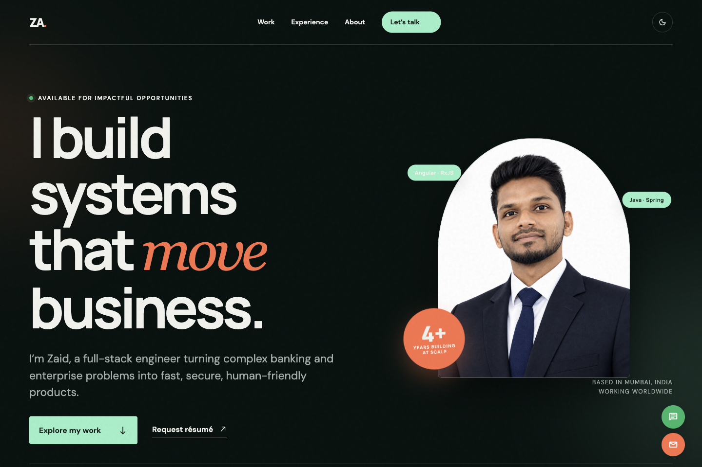

# Zaid Ansari — Portfolio

## UI preview



Actual UI captured from the unchanged public repository served locally. The professional profile belongs to Zaid; it is presented here as a portfolio website project.

[Project screenshots and notes ↗](https://github.com/taufiqueansari2621/project-showcase/blob/main/projects/zaid-portfolio.md) · [More projects ↗](https://github.com/taufiqueansari2621/project-showcase)

A responsive, accessible portfolio built from Zaid's professional experience in Java, Spring Boot, Angular, and enterprise systems.

## Run locally

No build step or dependencies are required.

```bash
python3 -m http.server 8080
```

Then open `http://localhost:8080`.

## Deploy

The site is ready for GitHub Pages. In the repository settings, select **Pages → Deploy from a branch**, then choose the `main` branch and `/ (root)` folder.
